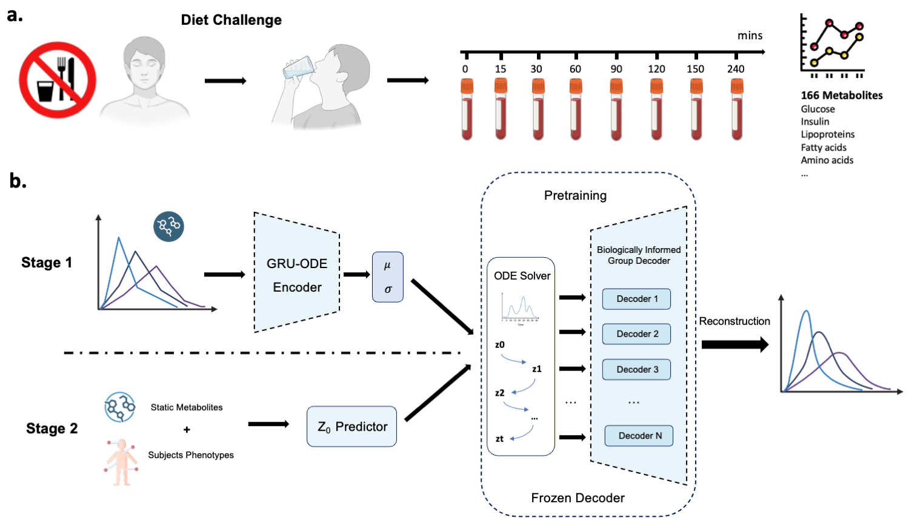

# A Biologically Informed Deep Dynamical Model Reveals Personalized Postprandial Metabolic Trajectories
This repository contains code for the manuscript "A Biologically Informed Deep Dynamical Model Reveals Personalized Postprandial Metabolic Trajectories". This study developed a two-stage latent neural ordinary differential equation (ODE) framework that models the dynamic patterns of postprandial metabolite trajectories. Stage 1 of the model captured postprandial dynamics from the reconstruction of metabolome time-series with a biologically informed group decoder. Stage 2 inferred postprandial trajectories using fasting state and basic phenotypic measurements without longitudinal observations.



## Installation

```
conda create -n latent_ode python=3.11
conda activate latent_ode
pip install -r requirements.txt        
```

## Data availability
Metabolome data are not publicly available.  Please reach out to Morten A. Rasmussen (\href{mailto:morten.arendt@dbac.dk}{morten.arendt@dbac.dk}) for data access requests.

